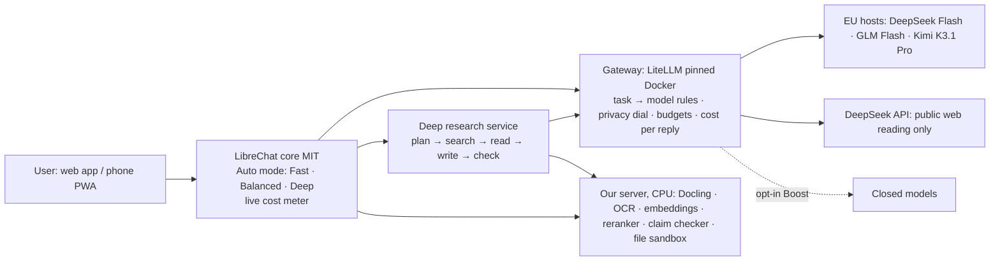

# 02 – Decisions after reviewing all three reports

Date: 2026-11-18. Inputs: our report (`reports/Custom AI workspace build options.md`), Gemini's audit, and ChatGPT's decision brief, taken with a grain of salt. Your priorities, in order:

1. **Data sovereignty.** You control where data goes.
2. **Security**, to a reasonable level.
3. **Cheaper and faster** at the **same or better quality.**
4. **Super intuitive** to use and **easy to distribute.**
5. **A general-use tool first.** Pick a niche later, based on who actually uses it.

Labels used below: ✅ checked against the source today · ⚠️ vendor or aggregator claim · 🧮 my arithmetic.

---

## TL;DR

1. **Open-weight first is right for you, but for sovereignty more than price.** An open-weight model can run on any server you choose (EU host, your own machine). A closed model always runs on its owner's servers. On price alone, cheap closed models (Claude Haiku 5.5, GPT-6 Luna at $0.10/$0.50) are as cheap as DeepSeek. That's why the other reports kept suggesting them.
2. **"Cheap Chinese API" and "sovereign" pull in opposite directions.** DeepSeek's own API stores data in China. **The same open models on EU hosts cost about 2x more** (🧮 $1.72/day vs $0.85/day for your usage), and that is still cheap.
3. **Smart compromise: two data lanes.**
   - Anything containing *your* data (chats, files, the research question, the final report) runs on **EU hosts**.
   - Reading *public web pages* during deep research runs on the **cheapest host** (DeepSeek API).
   - Result: 🧮 **about $1.20/day ($36/month)** for 100 chats and 2 deep research runs a day.
4. **Quality comes from the system, not just the model.** Use the best open model (Kimi K3.1 Pro) only for planning and writing. Check every citation with tiny local checker models. Prove it with a blind test against ChatGPT and Claude before building more.
5. **A 30% markup alone doesn't make a business.** Cheap models mean 30% of a small number. A typical user brings in about $2.50/month, so you'd need about 2,000 paying users for $5k/month. **Prepaid credits with the markup plus a small base fee (€5–9/month)** cuts that to roughly 450–650 users and still undercuts ChatGPT Business (about $20–25/seat).

---

## 1. Why the other reports kept recommending closed models

| Their reasoning | True? | What it means for us |
|---|---|---|
| The best open model trails closed mid-tier models. Kimi K3.1 Pro scores **46**; GPT-6.2 Sol scores **57** at $1.01 per task, vs $3.68 for Kimi ([Artificial Analysis](https://artificialanalysis.ai/leaderboards/models)) | Yes (independent) | On pure "quality per dollar", closed mid-tier models win at planning and writing. |
| Cheap closed models are as cheap as DeepSeek (Haiku 5.5 and GPT-6 Luna at $0.10/$0.50 per 1M tokens) | Yes | Open models don't win on price automatically. |
| Closed models break sovereignty: they only run on US-company clouds | Yes | **This is why open-first fits your priorities.** |
| Open models are faster on specialist hosts (1,000+ tokens/second) | ⚠️ vendor speed claims ([LithosAI via Gemini](https://www.lithosai.com/blog/lithosai-tops-artificial-analysis)) | Good for "faster", but has to be measured. |
| Open models make things up more | Partly. In *closed-book* tests they're far worse. When summarizing *given pages*, DeepSeek V4 Pro is about 8.6% vs about 9–10% for older closed flagships ([aggregator](https://suprmind.ai/hub/ai-hallucination-rates-and-benchmarks-in-2026)) ⚠️ | Safe for reading supplied sources; risky for answering from memory. Design around that. |

**Decision:** open-weight models by default. Closed models only as an **opt-in "Boost"** that the user turns on per workspace, labelled "leaves the EU / leaves open models".

## 2. Which model does each job (default, all open-weight)

The user never picks a model. The system picks by task; the user only picks the **effort level: Fast / Balanced / Deep.**

| Job | Model | License | Runs where | Why |
|---|---|---|---|---|
| Everyday chat (about 80% of turns) | **DeepSeek V4.1 Flash**, thinking off or low | MIT ⚠️ | EU host | Cheap, 1M context, sees images. Weak on hard reasoning. |
| Chores (titles, tags, memory, routing) | **GLM-5.3-Flash** or Qwen3.8-27B | MIT / Apache ⚠️ | EU host | Lowest price ($0.15/$0.50) and very fast. |
| Deep research: reading public web pages | DeepSeek V4.1 Flash | MIT | **Cheapest host (DeepSeek API)**: public data only | About 80% of research tokens go here. Server-side search is now free on DeepSeek's API ✅ ([DeepSeek pricing](https://api-docs.deepseek.com/quick_start/pricing)) |
| Deep research: planning and final report, "Deep" chats | **Kimi K3.1 Pro** | Open weights, custom "Kimi K3.1 Pro License" ✅ (terms to read) ([HF card](https://huggingface.co/moonshotai/Kimi-K3.1-Pro)) | EU host | Best open model: AA 46, near Opus on report writing. Slow (about 31–54 tokens/sec). |
| Citation checking | **Tiny "claim checker" models** (MiniCheck, FactCG) | MIT ⚠️ | **Our own server (CPU)** | Checks each cited sentence against its source page for close to $0. Flags go to Kimi. |
| Reading PDFs and Office files | **Docling** (MIT), PaddleOCR-VL for scans (Apache) | ✅ | Our own server | Parse once, never resend raw files. |
| Search inside projects | **Qwen3-Embedding + Qwen3-Reranker** (0.6B–8B) | Apache-2.0 ✅ | Our own server | No vendor, no per-call fee. |
| Making PDF / Excel / Word / PowerPoint | Model writes a **structured spec**, templates render it (openpyxl, pptxgenjs, docx), LibreOffice checks | Apache/MIT | Our own server (sandbox) | Removes most code-execution failures, which are the main cause of failed office files in benchmarks ([OfficeEval](https://arxiv.org/abs/2606.10956)) |
| Optional "Boost" (off by default) | GPT-6.2 Sol / Gemini 4 Hydrogen | Closed | US clouds | For users who choose quality over sovereignty. |

**Don't rent GPUs to run the big models yourself.** At your volume it costs **225–6,000x more** than paying per token ⚠️🧮 (Gemini's math; the direction is clearly right). Only the tiny helper models run on our own server.

## 3. Where models run: a "privacy dial" the user can see

| Setting | Data location | Example hosts | Your cost: per day / per month 🧮 | + 30% markup, per month |
|---|---|---|---|---|
| **EU only** (strictest) | EU data centres | Nebius ⚠️, OVHcloud ✅, Scaleway | **$1.72 / $51.70** | $67.30 |
| **Smart (recommended default)** | Your data in EU; public web reading via DeepSeek | EU host + DeepSeek API | **$1.20 / $36.10** | $46.90 |
| **Western-hosted open** | US | DeepInfra, Together | $0.97 / $29.00 | $37.70 |
| **Cheapest** (not sovereign) | China (DeepSeek, Moonshot) | First-party APIs | $0.85 / $25.40 (with Kimi) · $0.32 / $9.70 (DeepSeek only) | $33.10 · $12.60 |
| *Reference:* ChatGPT Plus | US | — | $0.67 / $20.00, about 25 research runs/month cap ⚠️ | — |

The 🧮 figures assume 100 chats/day at 8k tokens in and 600 out, plus 2 research runs/day.
- Each run is 1M tokens read and 20k written by readers, plus 200k read and 10k written by the planner/writer, plus 40 searches.
- Cache hits are assumed at **60%**, a realistic figure rather than the optimistic 85–90%.
- DeepSeek prices are blended at 80% off-peak.
- EU-host cache prices and Kimi's EU price are aggregator figures ⚠️ and must be confirmed.

Things that matter for cost and speed:
- **The host matters as much as the model.** For the *same* model, prompt-cache survival after a 15–20 minute pause ranged from **0% to 63%** depending on host. That made cost per 1,000 turns range from **$1.09 to $2.86** ⚠️. Keln ran this benchmark and is itself one of the hosts tested ([Keln](https://keln.ai/blog/ai-inference-provider-benchmark-2026)). We must measure our own hosts.
- **Spain gets cheap DeepSeek most of the time.** Peak hours are 01–04 and 06–10 UTC on weekdays, which is **02–05 and 07–11 in Spain** in winter (one hour later in summer). Afternoons, evenings and weekends are half price ✅ ([DeepSeek](https://api-docs.deepseek.com/quick_start/pricing)). Deep research can be queued for off-peak when the user isn't waiting.
- **More tokens bought almost no quality.** LangChain's research agent used 58M vs 207M tokens for a RACE score of 0.4309 vs 0.4344, so **hard budgets per run** are fine ([LangChain](https://github.com/langchain-ai/open_deep_research)).

## 4. Your 30% markup idea

How it works: users buy **prepaid credits**. Every reply shows its real cost, plus our 30% on top, live. No surprise bills, and no subscription required.

| User type (per month) | API cost, EU setting 🧮 | Our 30% | Users needed for $5k/month margin |
|---|---|---|---|
| Light (100 chats, 2 runs) | $1.72 | $0.52 | about 9,700 |
| Typical (400 chats, 10 runs) | $8.45 | $2.54 | about 2,000 |
| Heavy, like you (3,000 chats, 60 runs) | $51.70 | $15.50 | about 320 |
| Typical, with **+€7 base fee** | $8.45 + €7 | about $9.50 | **about 520** |
| Heavy, with **+€7 base fee** | $51.70 + €7 | about $22.50 | **about 220** |

- **Card fees eat small top-ups.** At roughly 1.5% + €0.25 per charge, a €5 top-up loses 28% of our markup and a €20 top-up loses 12% 🧮. **Minimum top-up: €20.**
- **Verdict:** keep the 30% markup, since it is transparent and fair, and add a **small base fee** that covers hosting, updates and the local helper models. A typical user would still pay about **€15–16/month total vs €20–25 for ChatGPT Business**.
- **The real risk:** the markup rewards *more* token use, while the product promise is *saving* tokens. The answer is to show the savings on screen ("this month you saved €X vs ChatGPT").

## 5. What I keep from each report

| Idea | From | Status | Decision |
|---|---|---|---|
| "Barbell": very fast cheap models plus one strong writer | Gemini | Sound | **Keep**, with Kimi as the open strong writer instead of GPT-6.1 Terra. |
| Tiny local helpers (parsing, OCR, embeddings, reranking, claim checking) | Gemini | ✅ licenses for Docling/Qwen; checker benchmarks ⚠️ | **Keep.** Big savings and better quality control. |
| Host choice matters (cache decay) | Gemini | ⚠️ vendor benchmark | **Keep, and measure ourselves.** |
| LiteLLM was hacked on PyPI (24 Mar 2026, about 40 minutes) | Gemini | ✅ ([LiteLLM advisory](https://docs.litellm.ai/blog/security-update-march-2026.md), [Heise](https://heise.de/-11224139)) | **Use LiteLLM only as a pinned official Docker image**, never `pip install` unpinned. |
| Switch to the Bifrost gateway | Gemini | ✅ Apache-2.0, but its README doesn't list DeepSeek, Moonshot, Z.ai or Nebius, and its MCP gateway may be enterprise-only ([repo](https://github.com/maximhq/bifrost)) | **Reject for now.** LiteLLM covers our hosts. |
| LibreChat admin panel is AGPL | Gemini | ✅ ([repo](https://github.com/LibreChat-AI/admin-panel)) | **Don't use it.** Configure via YAML. The core stays MIT. |
| Spain-specific (AEPD) rules on agentic AI | Gemini | ✅ the guide exists (Feb 2026, 81 pages) ([AEPD PDF](https://www.aepd.es/guias/orientaciones-ia-agentica.pdf)); "Rule of 2" attributed to AEPD ⚠️ unconfirmed | **Keep the spirit:** memory the user controls, separate audit logs, no "always allow" for send/delete. |
| Real-estate niche | ChatGPT | — | **Reject**, as you asked. General tool first. |
| Hide model choice and API keys; start from an example | ChatGPT | ⚠️ one vendor survey: 151/400 "unsure where to start", 144/400 "no time to learn" | **Keep.** This is core to "super intuitive". |
| Research job reliability (budgets reserved up front, retries, partial results) | ChatGPT | Sound engineering | **Keep.** |
| A blind research test before building more | All three | — | **Keep. This is experiment #1.** |

## 6. Architecture

Key technical decisions:
- **No model picker. ✅ LibreChat can do this.** "Model specs" hide the model picker, can point a choice at an agent, and can set reasoning effort ([docs](https://www.librechat.ai/docs/configuration/librechat_yaml/object_structure/model_specs)). We show three choices (Fast, Balanced, Deep) and the gateway does the rest.
- **Each conversation sticks to one model,** so the prompt cache isn't lost.
- **Cost meter:** LibreChat can't yet show the gateway's per-reply cost, and there's an open feature request ([LibreChat issue 1215](https://github.com/LibreChat-AI/LibreChat/issues/1215)). That's a **small patch in our fork**.
- **Security baseline:**
  - Don't expose admin or internal ports to the internet.
  - Block user-added local MCP servers. LibreChat had 2026 CVEs, including a 9.1 in this area.
  - Code and file generation run in network-blocked sandboxes.
  - Secrets are kept only in the gateway.
- **Distribution:**
  - (a) A **hosted web app** on an EU server: sign up and go, works on phones. This is the default and the easiest path.
  - (b) A **one-command Docker install** for companies that want everything in-house: maximum sovereignty and the same code.

## 7. Proof of demand: what we know and don't

| Signal | Strength |
|---|---|
| TypingMind (bring-your-own-key chat UI) reported $500k cumulative revenue and $15k/month (Feb 2024) ([via ChatGPT brief]) | Weak and old, but real money for this category |
| In one Spanish survey, 65 of 87 people who pay for AI spend ≤€50/month and 30 spend under €20 ⚠️ vendor survey | Sets a price ceiling for small businesses |
| EU firms using AI: 17% of small and 30% of medium firms (Eurostat 2025) ✅ ([Eurostat](https://ec.europa.eu/eurostat/statistics-explained/index.php/Use_of_artificial_intelligence_in_enterprises)) | Large room to grow; privacy is the top barrier in surveys |
| Nobody has shown demand for "EU-sovereign + cheaper ChatGPT" specifically | **Unknown.** Needs a landing page and waitlist test |

**Why hasn't someone done this well?**
- **Hosting:** EU hosting of the best open models has only just become available, and the catalogs are thin (OVHcloud has few big models).
- **Quality:** open models were well behind until late 2026.
- **Margins:** they are small, as section 4 shows.

The opening is real, and margins are thin. Distribution, not the technology, is the hard part.

## 8. Next: experiments before the design doc is final (about $15–25 total)

| # | Test | Pass if |
|---|---|---|
| 1 | **Blind research test**: 10 of your real questions on our open-only pipeline vs ChatGPT / Claude | Ties or wins on ≥7/10, at ≤$0.60 per run |
| 2 | **Host test**: replay a 30-turn chat with 5- and 15-minute pauses on 2 EU hosts and DeepSeek | Measured cache hits ≥50%; confirms EU prices and data-retention terms |
| 3 | **Tool-calling stress test**: 50 tool calls on DeepSeek Flash and Kimi on EU hosts | ≤2% broken calls after our repair layer |
| 4 | **LibreChat + gateway spike**: Auto mode, sticky model per chat, cost per reply in the UI | Works with config plus a small patch |
| 5 | **File test**: 12 real PDF, Excel, Word and PowerPoint requests, generated from a spec | ≥10/12 open correctly and look right |
| 6 | **Demand test**: a landing page ("ChatGPT-level, EU-sovereign, pay only what you use") | A signup rate we decide on before launch |

Still unverified, to check during the experiments:
- EU hosts' exact prices, cache pricing and data retention (Nebius, OVHcloud, Scaleway).
- The Kimi K3.1 Pro license terms.
- The claim-checker benchmarks.
- Whether the AEPD guide's memory rules mean anything specific for us.
