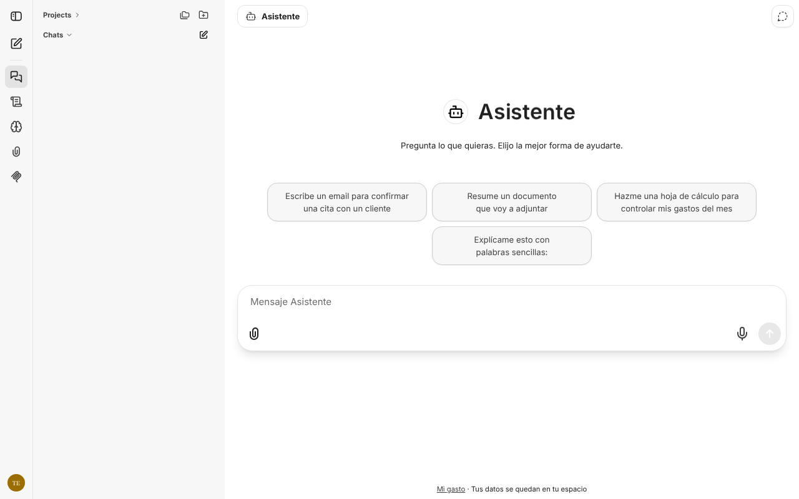

# Asistente: open-source AI workspace for small teams

Chat, documents (Word / Excel / PowerPoint / PDF), deep research with sources, memory, projects.
The software picks the cheapest open model that does the job well. Users never see model names.
They pay only what they use (real model cost + a small markup), with a "Mi gasto" page that shows it.



```
Browser -> Caddy (https) -> LibreChat (chat screen)
                              -> tools  (front door: files / deep research / "Mi gasto")
                              -> LiteLLM (model router + cost tracking) -> open models via OpenRouter (MVP)
```

## Install (any Linux server or PC with Docker)
```bash
git clone https://github.com/NaimGQKC/new-claude.git && cd new-claude/mvp
./install.sh
```
It asks for your OpenRouter key and (optionally) a domain, creates all secrets, and starts everything.

## What the user sees
- **Asistente**: normal chat. The router sends easy questions to a cheap model and hard ones to a stronger one.
  Asking for a file ("hazme una hoja de cálculo...", "prepara una presentación...") creates a real file with a download link.
- **Images**: "crea una imagen para un post de Instagram sobre..." makes a simple marketing image (closed Google model, about $0.04 each; no open image model is on OpenRouter).
- **Industry packs** (`tools/packs/*.json`): when the user (or memory) says they work in real estate, a clinic, a law office, accounting, hospitality, retail or marketing, the matching pack switches on by itself: better instructions and a one-time "Modo X activado" line. Packs are plain prompt files (no code), so adding a vetted community pack means dropping in one JSON file.
- **Email without a connector**: paste an email and the assistant gives a one-line summary, what is asked, and a draft reply in the user's tone (from memory).
- **Reading documents**: long attached text goes to the cheap long-context model; only legal/financial analysis goes to the strong one. Decisions are logged (one JSON line per message) so we can tune the rules.
- **Pensar más**: always the strongest model, slower.
- **Investigación profunda**: plans searches, reads many pages, writes a cited report, flags claims the sources don't support.
- **Memory**, **Projects**, **export chat**, voice input and file upload come from LibreChat.
- **Mi gasto** (footer link, `/gasto`): spending this month in euros.

## Models (litellm/config.yaml)
| Job | Model |
|---|---|
| Easy chat, page reading, memory, titles | DeepSeek V4.1 Flash |
| Normal analysis | DeepSeek V4.1 Flash with thinking on |
| Long writing | GLM-5.3 |
| Hard reasoning, "Pensar más", research planning and writing | Kimi K3.1 Pro (license to review before selling) |
Switching host (OVH, T-Systems, Berget...) means editing the `model:` lines in `litellm/config.yaml`.
The MVP runs on OpenRouter: use fake or non-sensitive data until we move to an EU host.

## Tests
- `python3 -I tests/route_test.py`: sends sample prompts through the router and prints model, tokens, cost (spends a few cents).
- `python3 -I tests/test_frontdoor.py`: 17 free checks of file/image/pack/model decisions.
- `RESEARCH_DRY=1` runs the tools service with fake models and real page fetching (no spend).

## Status (2026-11-19)
Tested with real models (about $0.18 total): chat routing, industry pack, pasted email, "Pensar más", Excel/PowerPoint/Word creation,
image with Spanish text, long-document reading, and two deep research runs with cited reports. See `tests/RESULTS.md` and `samples/`.
Also tested: the whole Docker stack starts, LibreChat accepts our config, spend page, spending cap, cost estimates, 22 free front-door checks.
**Not tested:** LibreChat in a browser with real models (memory, titles, file upload), OCR for scans, Windows install, quality vs Claude/Perplexity.
LibreChat v0.8.8/0.8.9 images are not published, so we pin v0.8.7 (partial Spanish UI; text size is the default, users can zoom with Ctrl +).

## Next
Quality test on real prompts (blind vs Claude/Perplexity), Spanish evaluation, pre-built agents/MCP connectors, browser agent,
EU hosting, license review for Kimi, larger text via a small LibreChat theme patch.
